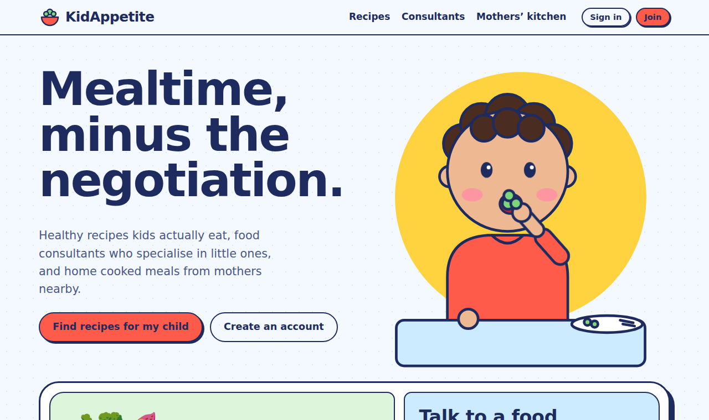

# KidAppetite 🥦

**Healthy food kids actually eat, with expert help when you need it.**

KidAppetite pairs a library of kid approved, genuinely healthy recipes with real children's food consultants, so mealtime stops being a negotiation and starts being easy. Parents can also order home cooked meals from approved mothers nearby who have a child the same age.

**Live demo:** https://elibabakhani.github.io/KidAppetite/

---

## Product at a glance

| | |
| --- | --- |
| **Problem** | Feeding young children is a daily source of stress, and it gets much harder when a child has autism, diabetes, celiac disease, reflux or allergies. Good advice is scattered and specialists are hard to reach. |
| **Users** | Parents of children aged 6 months to 4 years, mothers who want to cook for other families, and children's food consultants |
| **Solution** | Three connected services: personalised recipes, consultant booking, and a neighbourhood kitchen of approved home cooks |
| **Stage** | Clickable prototype with all core flows working end to end |
| **My role** | AI Product Manager |

---

## My role

I lead KidAppetite end to end as its AI Product Manager. In practice that meant:

* **Discovery:** framing the problem, defining who we serve first, and researching the market and the conditions that make feeding hardest
* **Product definition:** writing the vision, the user roles (parent, mother, consultant, admin) and the requirements for each core flow
* **Prioritisation:** deciding what the MVP must prove and what waits, using a MoSCoW scope (below)
* **Experience design:** setting the design direction (sharp, friendly, built for tired parents on a phone) and the trust signals families need before they order food or book an expert
* **Building the prototype:** building a working prototype so I could test real flows instead of static mockups
* **Metrics and launch planning:** defining the north star, the supporting metrics, the guardrails and the pilot plan

---

## Why I started KidAppetite

KidAppetite started with a close friend. She was busy with work, and at the same time she had real concerns about her little ones' feeding: what to cook, what was healthy for their age, and who to ask when something did not seem right.

Seeing how hard it was for her to balance both, I realised that many working parents carry the same worry every day. I built KidAppetite to give them one place to find food that fits their child, reach a specialist when they need one, and order a healthy home cooked meal on the days there is no time to cook.

---

## Market research

### How big is the pain?

* **Picky eating is close to universal in toddlers.** Around half of children are seen as picky eaters by 24 months, and roughly 36% of toddlers overall ([Carruth et al., 2004, via Stanford Medicine](https://med.stanford.edu/content/dam/sm/neonatology/documents/pIcky_eaters_031814.pdf)).
* **Feeding is far harder for autistic children.** Studies report feeding problems in 50% to 90% of children with autism; one preschool study found them in 76% ([Nygren et al., Frontiers in Pediatrics, 2021](https://frontiersin.org/articles/10.3389/fped.2021.780680/full)).
* **Food allergies shape everyday meals.** About 7.5% of Canadian children have a self reported food allergy ([Clinical and Translational Allergy, 2014](https://link.springer.com/article/10.1186/2045-7022-4-S1-P16)), and 2.5% have one documented by a physician ([AAAAI summary of Singer et al.](https://www.aaaai.org/Tools-for-the-Public/Latest-Research-Summaries/The-Journal-of-Allergy-and-Clinical-Immunology-In/2020/canada)).

### How big is the market?

* The North America baby food and infant formula market was valued at about **USD 11.6 billion in 2025**, growing around 4.8% a year ([IMARC Group](https://www.imarcgroup.com/north-america-baby-food-infant-formula-market)). Estimates vary by report and definition, so I treat this as a signal of spend, not a precise target.
* Industry reports highlight rising demand for **allergen free, clean label and plant based** options, growth in **subscription and e‑commerce** buying, and homemade food as a strong preference among parents ([ResearchAndMarkets via GlobeNewswire, 2025](https://www.globenewswire.com/de/news-release/2025/05/15/3082323/28124/en/North-America-Baby-Food-Market-Forecast-Report-and-Company-Analysis-2025-2033-Featuring-Kraft-Heinz-Abbott-Hero-Hain-Celestial-Nestle-Reckitt-Benckiser-Amara-Organics-Danone-Lactal.html)).

### Competitive landscape

| Alternative | What parents get | What is missing |
| --- | --- | --- |
| Recipe apps and blogs | Lots of ideas | Not tailored to a child's age, conditions or allergies |
| Packaged baby food | Convenience | Less fresh, little variety for older toddlers, not personal |
| Dietitian clinics and telehealth | Expert advice | Hard to find a children's specialist, long waits, advice not connected to daily meals |
| Home cook and meal marketplaces | Home style food | Not designed for young children, allergens and age fit are unclear |

**KidAppetite's position:** the only place that connects *what to cook*, *who to ask* and *what to order*, all filtered for one specific child.

---

## Users and their jobs

| Persona | Job to be done | What success looks like |
| --- | --- | --- |
| **Busy parent** of a picky toddler | "Help me get healthy food into my child without a fight." | Finds a recipe the child eats within the first week |
| **Parent of a child with a condition** (autism, diabetes, celiac, allergies) | "Help me feed my child safely and get real expert advice." | Books a specialist and leaves with a plan |
| **Mother who cooks** | "Let me earn from cooking I already do, for kids like mine." | Approved, posts meals and sells out regularly |
| **Food consultant** | "Bring me the families I specialise in and fill my calendar." | High booking rate with the right patients |

---

## Solution and MVP scope

| Priority | In the prototype |
| --- | --- |
| **Must have** | Child profile, recipe matching with hard allergen filters, consultant directory and booking, daily meal posting and ordering, approval flow for cooks and consultants |
| **Should have** | Condition guidance notes, "fits your child's age" matching on meals, consultant availability editor, earnings view for mothers |
| **Could have** | Saved favourites, reviews and ratings, reorder |
| **Won't have yet** | Payments, delivery, messaging, native mobile apps |

### Key product decisions

* **Safety beats ranking.** Allergens and celiac exclusions are hard filters that remove recipes entirely, while softer needs (fibre, texture, no added sugar) only change the order. A wrong suggestion should never be dangerous.
* **Approval before earning.** Mothers and consultants are reviewed before they appear. This slows supply growth but trust is the product.
* **Recipes are free, expertise is paid.** Recipes bring families in; consultations and meals are where value and revenue are exchanged.
* **No medical claims.** KidAppetite gives general food ideas and routes real questions to specialists.
* **Start small in one community.** A home cook marketplace only works when buyers and cooks live close together, so the pilot stays local and focused rather than wide.

---

## Metrics

### North star

**Weekly families with a successful mealtime action:** families who cook a matched recipe, complete a consultation, or receive a meal order in a given week. It captures the real outcome (a child gets fed well) across all three services.

### Supporting metrics

| Area | Metric | Why it matters |
| --- | --- | --- |
| **Activation** | % of new parents who create a child profile and view matched recipes in their first session | Shows the first value moment is reached |
| **Recipes** | Recipes saved or marked "cooked" per family per week | Engagement with the free core |
| **Consultants** | Search to booking conversion; consultant calendar utilisation | Demand and supply health for experts |
| **Kitchen** | Sell through rate (portions ordered ÷ posted); repeat order rate | Marketplace liquidity and food quality |
| **Supply** | Approved cooks per neighbourhood; time from application to approval | Can supply keep up with demand |
| **Retention** | Week 4 and week 12 family retention | Whether KidAppetite becomes a habit |
| **Revenue** | Gross order and booking value; take rate | Business viability |

### Guardrails

* **Zero** allergen incidents from meals or recipes
* Order issue and refund rate below an agreed threshold
* Consultant no show and cancellation rate
* Parent satisfaction (CSAT) after each consultation and order

### Pilot targets (hypotheses to validate)

* 40% of new parents reach matched recipes in their first session
* 60% average sell through on posted meals
* 25% of families active again in week 4

---

## Business model (hypotheses)

* **Meal orders:** platform fee on each order
* **Consultations:** commission on each booked session
* **Family Plus subscription:** saved plans, priority booking and condition specific recipe packs
* **Partnerships:** clinics and parent organisations referring families

---

## Go to market

1. **Pilot one neighbourhood** with a small group of approved cooks and 3 to 5 consultants.
2. **Reach parents where they already are:** local parent groups, daycares, community centres and pediatric clinics.
3. **Recruit supply first:** onboard cooks and consultants before opening orders so the first visit never shows an empty menu.
4. **Expand neighbourhood by neighbourhood** once sell through and retention hold.

---

## Risks and mitigations

| Risk | Mitigation |
| --- | --- |
| **Food safety and regulation** for home cooked food | Confirm local health authority rules and permits, require food safety certification, allergen labelling and insurance before launch |
| **Children's health data privacy** | Explicit consent, encryption, minimal data collection, compliance with privacy law (for example PIPEDA in Canada) |
| **Medical liability** | Clear "not medical advice" positioning, dietitian review of every recipe and guidance note, specialists handle individual advice |
| **Two sided cold start** | Dense single neighbourhood pilot and supply recruited before demand |
| **Trust** | Approval process, verified credentials, reviews, transparent allergen information |

---

## Roadmap

| Now | Next | Later |
| --- | --- | --- |
| Clickable prototype live on GitHub Pages | Parent interviews, pilot cooks and consultants, real accounts and database, payments, verified credentials | Reviews, delivery, messaging, meal plans, mobile app, more cities |

### What I want to learn next

* Do parents trust food from a neighbour enough to order? (concierge test with a few families)
* Which conditions bring the highest willingness to pay for a consultation?
* What price per portion keeps both cooks and parents happy?

---

## Try the demo

Open the [live demo](https://elibabakhani.github.io/KidAppetite/) and choose **Sign in** to switch between sample accounts:

| Account | Shows |
| --- | --- |
| Sara Moradi | A parent with a picky toddler and a booked session |
| Lena Park | An approved mother who cooks |
| Carla Mendes | A mother waiting for approval |
| Dr. Nadia Rahimi | A consultant with a booking |
| KidAppetite Team | The approvals screen |

Demo data is saved only in your browser. Use **Reset demo data** in the footer to start fresh.

## How it is built

A single page web app in plain HTML, CSS and JavaScript with no build step, hosted on GitHub Pages. It uses hash based routing and stores demo data in the browser. Production plans include a backend with role based access (for example Supabase), Stripe Connect for payouts, and calendar sync.

---

*KidAppetite shares general food ideas, not medical advice. Families should always check with their child's doctor or dietitian.*

**Elnaz Babakhani** · Product Manager and Founder
[LinkedIn](https://www.linkedin.com/in/elnaz-babakhani/) · [Portfolio](https://elibabakhani.github.io/MyPortfolio/) · [GitHub](https://github.com/EliBabakhani)
